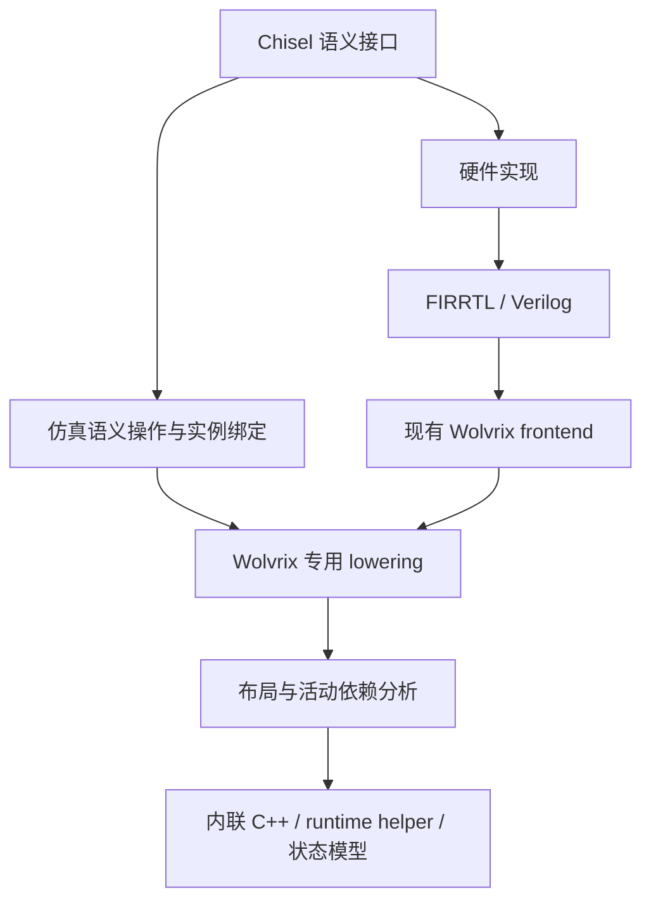

# Chisel 语义接口、双实现与 Wolvrix 接入设计

状态：研究设计；当前已增加一个受版本契约保护的 GrhSIM 专用
`kCountTrailingZeros` 实验实现，尚未把它作为通用公共模型插件 ABI。
实验依据见 [扩展实证](../../../pdocs/grhsim_opt_thj/TNO0377_chisel_pattern_expanded_evidence_20261029.md)
和 [真实 MSHR 计数](../../../pdocs/grhsim_opt_thj/TNO0378_chisel_pattern_frozen_mshr_count_20261029.md)。

## 为什么需要保留语义

### 当前实验：PriorityEncoder 的同名 utility 包装

`testcase/xiangshan/utility` 提供了同名 `utility.PriorityEncoder`，默认分支直接
调用完整限定名 `chisel3.util.PriorityEncoder`。在一次 XiangShan elaboration
作用域内通过 `--wolvrix-sim-primitives priority-encode` 才选择仿真原语；关闭时
生成结果与原有硬件实现相同。Parallel、WithFlag 和 Default 包装保持自己的公共
接口和零输入/默认值语义。

开启时，utility 将输入送入无时钟模块中的 `IntrinsicExpr("circt_dpi_call", ...)`，
名称为 `wolvrix_ctz_v1_w<N>`。这是 Verilog 中的中转契约：firtool 当前仍生成
`context function void` 加 `output int`，Wolvrix 导入器验证后把调用转成
`kCountTrailingZeros`。因此最终生成的 GrhSIM C++ 没有 DPI 调用或外部实现依赖。

原语是普通组合数据流的一部分：输入使用现有 ValueId，结果单一定义，活动从真实
输入传播，常量折叠/CSE/DCE、跨组物化和变化检测沿用原有路径。对宽值只保留完整
输入依赖，不能把硬件内部的每个优先级树节点误报成独立仿真活动。

### 2026-11-03：PopCount 的布局门控实证

同名 `utility.PopCount` 已加入 `Bits/UInt` 与 `Vec/Seq` 两类重载。只有紧凑的 packed
输入进入 `wolvrix_popcount_v1_w<N>` 和 `kCountOnes`；`Vec[Bool]`、`Seq[Bool]` 保持
`chisel3.util.PopCount` 的硬件树。香山完整生成中 1,095 个 packed 调用进入 intrinsic，
7,140 个分布式调用保留硬件。node030 CPU96 的 8 对单线程 C100000 测量中，B 平均
回退 0.665717%，因此这条路线目前只作为实验入口，不默认开启。详细数据见
[TNO0397](../../../pdocs/grhsim_opt_thj/TNO0397_popcount_intrinsic_packed_layout_walltime_20261103.md)。

宽度消融使用独立模式 `popcount-ge4`：它让 1–3 位 packed PopCount 保留硬件，仅替换
宽度≥4 的 405 个调用。该轮 8 对测量 B 平均回退 1.136902%，95% 区间跨零；因此阈值
4 也暂不成为默认策略，详见 [TNO0398](../../../pdocs/grhsim_opt_thj/TNO0398_popcount_ge4_intrinsic_walltime_20261103.md)。

### 2026-11-03：Gray-to-binary 的 packed 原语接入

utility 层新增 `GrayToBinary`。它的默认实现使用对数级移位异或前缀，保持原有硬件
生成；单次 elaboration 选择 `--wolvrix-sim-primitives gray-decode` 时，只有 packed
`Bits/UInt` 输入改走 `IntrinsicExpr("circt_dpi_call", ...)`，调用名为
`wolvrix_gray_decode_v1_w<N>`。`Vec[Bool]` 没有这个入口，避免自动增加打包成本。

Wolvrix 导入器把这个版本化 transport 转成同宽的 `kGrayDecode`，输入和输出都是
普通组合 SSA 值；GrhSIM 的单字和多字 C++ helper 均已生成并通过功能检查。DPI 的
`context function` 仍只是 Verilog 中转形式，生成的 C++ 不保留 DPI 调用。

目前 XiangShan/Rocket-Chip 源码中的 `GrayCounter` 是 Gray 编码器，尚未发现可在不
改变语义的情况下直接替换的完整 Gray-to-binary packed 调用。因此本轮只完成 utility、
Verilog、GRH 和 C++ lowering fixture，没有据此宣称香山整机 walltime 收益；完整整机
测量须先找到实际使用点或加入明确的局部调用。

## 行为模型 API：先复用 GRH 状态，再按实测增加专用 lowering

行为模型与纯组合 intrinsic 的目标不同。它允许在 Chisel elaboration 阶段用另一套代码
描述 observer/debug 状态，但必须保留时钟、复位、更新条件和输出依赖。当前入口为：

```text
--wolvrix-sim-models hardware
--wolvrix-sim-models commit-rat
```

`hardware` 是默认模式。`commit-rat` 模式使用 utility 中的 `SimulationModels` API，模型
作者可以声明 `input`、同步 `register`、小型 `memory`、`update` 和 `output`。这些调用
仍然生成普通 Chisel 状态和组合逻辑，不是 BlackBox 或不透明 DPI。生成阶段同时写出
`build/simulation_models.json`，其中包含模型版本、observer-only 属性、时钟/复位、状态
布局、输入输出、debug capability、检查输出和更新组。

第一版刻意不新增 `kBehaviorRegister` 或 `kBehaviorMemory`。现有 GRH 已经把
`kRegister/kMemory` 纳入 source/sink 分类、commit phase、state-reader 激活、变化检测和
scalar commit write 优化。增加同语义的 OperationKind 不会自动减少运行时工作；实际
性能收益首先来自裁剪 DiffTest 字段和 Gateway/Preprocess 路径。

如果普通 GRH 行为模型的状态更新仍是热点，后续应增加**分组级**的专用状态 lowering，
而不是逐个复制 Register/Memory 类型。该 lowering 必须显式携带输入、状态、更新条件、
commit 事件和输出依赖，使 scheduler 与 activity analysis 可见；C++ emitter 才能把一组
observer commit 更新合并成一次 helper，并跳过不必要的 state shadow、event guard 和
fixed-point 反馈。模型 manifest 会作为 lowering 的边界和校验输入，当前 Python GrhSIM
驱动会把它复制到生成模型目录，但默认仍走普通 GRH 状态路径。

示例 fixture 为 `testcase/chisel-intrinsic/BehaviorModelStudy.scala`，脚本为
`scripts/behavior_model_study.py`。它生成硬件版和 `commit-rat` 版相同端口的 RTL；行为
版 manifest 声明 32 个架构寄存器、32 个 RAT 寄存器、commit/RAT 输入和两个状态输出。
Wolvrix frontend 将行为版状态识别为普通 `kRegister`/`kRegisterWritePort`，没有引入
专用 OperationKind。

当前实验覆盖 `1,2,3,4,5,6,7,8,9,10,14,15,16,17,31,32,33,36,38,63,64,65,
127,128,129,255,256,257,511,512,1024` 位的打包和分散 Bool 输入；实际 XiangShan
配置额外包含 `5,6,10,14,36,38` 位。所有宽度都保留为矩阵项，不按速度挑选。

同一个逻辑功能可以有不同的硬件结构和软件实现。研究观察到：

- PriorityEncoder、GrayToBinary、向量旋转、完整查表和递归计数谓词，有明显的语义恢复机会。
- PopCount 对已打包输入较合适；实际 MSHR 的分散 bool slot 需要收集，单次 popcount
  并不自动胜过已有加法树。接口应描述计数语义，把物理布局留给后端。
- 固定小排序网络、部分 mux 和 ECC parity 已经较紧凑，换成通用算法可能退化。
- 状态表的读写、重置、握手和观察方式比某一条 CPU 指令更重要。完整组件模型需要
  精确时序契约，不能只比较最终数值。

因此建议扩展的是**有类型、有依赖、有可验证契约的操作和组件**。同一个接口的 hardware
分支保留面向综合的电路，simulation 分支可以是不可综合的算法、数据结构或 C++ 实现。



这个图允许局部操作绕过硬件展开，同时让其余设计继续使用现有流程。完整设计直接从
elaboration 导入是另一条更大范围的路线，见后文。

## 三种粒度的接口草案

以下名字是说明契约的伪代码，不是已经可调用的 API。

### 纯组合操作

```scala
Dual.pure(
  semanticId = "wolvrix.popcount.v1",
  inputs = Seq(x),
  result = UInt(log2Ceil(x.getWidth + 1).W),
  hardware = () => PopCount(x),
  simulation = ModelRef("popcount", version = 1)
)
```

最低契约包括：操作名/版本、输入输出类型和位宽、符号、常量参数、二态/四态策略、
所有数据依赖、来源、纯函数属性。硬件分支按需 elaboration，避免同时生成两个有状态
实现或执行两次注册副作用。

`popcount` 的定义是返回输入中为 1 的位数；输出宽度足以表达输入宽度，若调用者再
截断，应保留单独的截断语义。`Seq[Bool]` 和 packed UInt 可以属于同一逻辑操作，但
布局描述不同。后端比较已有 packed view、gather、直接求和和跨字计数；没有成本证据时
不强制打包。输入分散时不得把 gather 的成本藏到操作之外。

类似契约可表达：priority encode（含无命中输出）、bit extract（含 bit 顺序）、rotate
（含长度和方向）、Gray decode、完整 LUT。对于 one-hot mux，必须明确定义零选与多选
行为或提供可验证的输入域约束，不能从函数名字推断。

### 组合算法块

```scala
Dual.pure(
  semanticId = "wolvrix.stable_select.v1",
  inputs = Seq(valids, keys, payloads),
  parameters = Seq(ordering, tieBreak, invalidPolicy),
  hardware = () => hardwareSelection(...),
  simulation = ModelRef("stable_select", version = 1)
)
```

算法块适合把比较与宽 payload 搬移分开，或者用直接表查找代替布尔译码。接口必须明确
稳定性、相等键次序、invalid 位置、环形比较和所有输出。例如 CAM 返回全命中位图时，
哈希表不能丢失重复键或条目索引。CRC 模型必须携带多项式和位序，不能笼统指定“CRC 指令”。

数据源存在副作用时，不允许用软件短路、重排或缓存改变读取次数。纯算法内部可以由
后端优化；外部依赖仍由调度器精确追踪。更大粒度也会降低活动敏感度，需要评估部分
输入变化后是否必须重算整个块。

### 有状态组件

建议的逻辑接口为：

```text
initialize(parameters, initialization_policy) -> state
evaluate(old_state, inputs) -> outputs
plan_update(old_state, inputs, events) -> staged_state
commit(staged_state) -> new_state, changed_state_domains
project_observables(state) -> declared_internal_observables
```

- `evaluate` 不改变模型状态，可在固定点求解中重复调用。
- `plan_update` 基于同一份旧状态计算本次事件的更新，明确端口优先级与时钟边沿。
- `commit` 每个事件执行一次；后续组合计算读取新状态，并按真实输出/状态变化激活读者。
- 同一组件被不同分区使用时，要么明确单一状态 owner 和快照传递，要么证明读副本的
  一致性；不能让每个 worker 各自更新同一份逻辑状态。
- 日志/DPI 等可见副作用作为有序事件单独提交，不能随重复 eval 执行多次。

以 indexed storage 为例，契约需给出深度、元素宽度、读延迟、各写口 enable/address/
mask/data、冲突优先级、越界、reset/init 和 read-under-write。软件可以使用数组，但
同步读端口不能因为 host 数组访问方便而提前一拍输出。

Queue 还要声明 flow/pipe、flush、满空和同拍入出队规则。AgeDetector 如果改成时间戳，
必须证明同拍入队次序、回绕、无效项及内部观察的投影；当前研究未证明这一替代。

## 三条接入路线

| 路线 | 能解决的问题 | 接入与限制 |
|---|---|---|
| GRH 子图识别 / emitter combine | 已有 RTL 无需改动；适合可结构证明的纯操作 | 展开后语义可能难恢复；需维护作用域、共享用户、宽度与活动依赖 |
| Chisel 显式语义标记 + 局部导入 | 保留 PopCount、rotate、indexed storage 等意图 | 需要 occurrence→IR 绑定和消费者；普通未知 annotation 不会自动起效 |
| elaboration 直接导出自定义 IR | 在电路展开前保留更多算法和组件边界 | 完整设计还需承接宽度、连接、条件赋值、存储和事件语义 |

近期建议先评估第二条的局部导入，同时让第一条覆盖已有设计。接口语义与 backend
lowering 分开：自定义操作先可以存在于 GrhSIM 专用 overlay，不要求立即改公共 GRH
枚举；若多个 emitter 都要理解它，再考虑有版本的公共操作和序列化。

### 当前版本实际有哪些入口

本机 Chisel 7.3.0 的 `IntrinsicExpr` 能记录 `DefIntrinsicExpr`（名称、结果类型、参数、
输入与 SourceInfo）；DPI API 使用 `circt_dpi_call`。这证明可表达自定义意图，但不证明
firtool 或 Wolvrix 已认识新的操作名。

`circt.stage.ChiselStage.elaborate` 返回 `ElaboratedCircuit`；公开接口提供 serialize、
annotations、topDefinition 等有限检查能力，底层 `_circuit` 标记为 `private[chisel3]`。
因此完整 IR 遍历需要受控的 Chisel 侧导出层、版本固定的扩展或上游接口支持，不能把
拿到 elaboration 对象等同于已经有稳定的公共图遍历 API。

这里还必须区分：

- **跳过 Verilog 和文本往返**：可以研究直接消费结构化 elaboration 结果。
- **完全不使用任何 FIRRTL 形式**：当前 Chisel 内部 command/circuit 本身使用内部
  FIRRTL 表示。要满足这个更强目标，需要明确捕获自定义语义操作的位置及其与普通
  Chisel 电路的连接方式，而不是把 CHIRRTL 序列化改名后声称已经绕过。

固定版本源码可在研究产物 `survey/sources/chisel-7.3.0/` 检查，重点为
`chisel3/Intrinsic.scala`、`chisel3/ElaboratedCircuit.scala` 和 `circt/stage/ChiselStage.scala`。

### 局部旁路的连接与回退

语义操作的实例记录至少需要：逻辑操作 ID/版本、独立的 occurrence ID、层次实例、
参数与明确类型、输入输出绑定、来源、硬件参考实现和仿真实现身份。作用域内的网络
绑定必须在 flatten/rename 前建立并随变换传递；不能靠最终 Verilog 模块后缀或信号名猜测。

对于一部分操作直出 IR、其余电路继续走 RTL 的混合路线，必须同时定义边界端口和
稳定绑定清单。即使被旁路的内部硬件未生成，也必须保留它与其余设计的输入输出连接，
且不能让替代组件与原硬件状态同时生效。

可选模型不存在时，可明确回退到保留的硬件实现。一旦选择了语义替代，若绑定、类型
或模型版本不匹配，应报错或整体回退该组件；不能让现有 blackbox-guard 创建空 stub
后继续得到貌似成功的仿真。

## 嵌入 C++ 的方式与优化能力

可以允许 Scala wrapper 引用 C++ 源文件、内联代码资源或预定义模型符号。实现身份
包含内容哈希、编译选项、目标 CPU/ABI 和模型版本，用于复现与缓存失效。

纯操作优先让 Wolvrix 直接发射表达式或可内联 helper，便于 CSE、常量折叠和消除
中间物化。DPI/外部调用适合较大或有外部依赖的模型，但其调用/打包/优化边界需要单独
测量；本轮没有测出通用 DPI ABI 开销，不宣称它总是更慢。

不能从“实现是 C++”推断它是纯函数。需要显式声明并验证依赖、状态所有权和副作用。
未知代码按保守模型处理，不能被 CSE、提前调用或随活动跳过。

CPU 指令选择也属于后端：例如 BMI2 的 pext/pdep 仅是某些目标上的 lowering；无对应
指令时选择可验证的普通 C++ 路径。接口不把某一台机器的最佳指令写成硬件功能语义。

## 自定义 IR 最小记录与实现工作

以下是候选 schema，尚未成为 GRH 序列化格式：

```json
{
  "semantic_id": "wolvrix.popcount.v1",
  "occurrence_id": "stable-elaboration-occurrence",
  "parameters": {"input_width": 16, "logic_domain": "two_state"},
  "inputs": [{"name": "x", "type": "UInt", "width": 16, "binding": "value-id"}],
  "outputs": [{"name": "count", "type": "UInt", "width": 5, "binding": "value-id"}],
  "dependencies": {"count": ["x"]},
  "effects": [],
  "state_domains": [],
  "source": {"span_id": "source-span", "instance_path": "hierarchy-path"},
  "hardware_reference": {"content_hash": "hash", "binding_manifest": "manifest"},
  "simulation_model": {"id": "popcount", "version": 1, "content_hash": "hash"}
}
```

`inputs`/`outputs` 是具有确定类型的逻辑端口，`binding` 指向混合图的值；不能使用 C++
内存地址作跨构建身份。`dependencies` 表示某输出需要哪些输入，供活动计算使用。
`effects` 表示日志、DPI 或外部资源访问；空列表才允许按纯操作处理。`state_domains`
描述当前状态、事件与更新端口，有状态模型不能把它留空。`source` 同时保留声明来源和
具体实例身份。输入布局、host pointer 和 target ISA 应留在 lowering 信息中，不改变逻辑契约。

有状态记录还需列出事件端口（clock、edge、reset）、初始化规则、状态类型、读写冲突
策略、update/commit 次序和观察投影。以同拍写入索引 3 再组合读取索引 3 为例，应明确
沿前读取旧值、沿后读取新值；如果原读口同步且带一拍延迟，沿后输出仍由该读口的旧
地址/使能状态决定。不同 read-under-write 模式不能共用一个模糊的 `array_read`。

局部操作接入的工作边界是：

1. Chisel wrapper 产生语义记录与硬件参考分支，并固定 occurrence/binding 身份。
2. 导出/导入层验证位宽、参数和作用域，保证 flatten、复制和重命名后仍能绑定。
3. Wolvrix 选择 overlay 或新操作表示，明确普通电路与被旁路子图的边界和回退。
4. GrhSIM 生成内联 helper、依赖及变更检测，同时保存来源和模型身份。
5. 对局部操作与真实设计两层差分，再做生产 binary 的性能评估。

这仍是一条跨 Chisel、导入和 emitter 的纵向实现，不是增加一个 Scala 函数后自动完成。
纯组合例子可以先覆盖上述流程；组件级接入还要增加状态 owner、快照、重复 eval、
commit 一次性及外部观察验证。

完整 elaboration 前端还增加下列工作，不能用局部入口的工作量估计：

- 全类型与 aggregate/方向展开、参数和未知宽度求解、signed/truncate 规则。
- 条件连接、连接覆盖优先级、动态索引、无驱动值和初始化语义。
- 各种 memory/端口、事件控制、复位和多时钟，以及 blackbox/DPI。
- hierarchy、实例复制、annotations、SourceInfo 和稳定身份的持续传递。
- 与 firtool/当前 RTL frontend 的结构与功能回归，覆盖现有 XiangShan 文件集。
- 版本适配：当前公共 ElaboratedCircuit API 不提供任意内部图遍历，需要固定导出协议。

因此局部旁路是范围可控的验证入口；完整前端是独立的长期编译器工程。当前工具和实验
只完成候选发现、正确性/成本证据和接口设计，未把这两条路线标成已经实现。

## 验证层次与推进依据

第一阶段维持二态周期契约；若要用于四态 RTL，必须单独规定 X/Z 行为并验证。
对于状态表示变化，区分保留全部物理状态映射与仅保留声明观察投影；后者不能自动
宣称所有内部波形一致。允许时序延迟变化的行为模型属于另一个明确模式。

模型启用前需要：

1. 硬件参考实现与软件模型的局部差分／可行时形式证明，覆盖输入域和边界条件。
2. 模型重复 eval 无副作用、同拍 commit 一次、复位与握手时序检查。
3. source/binding 传递和 unknown-model 回退测试，以及模型版本和输入身份检查。
4. 带真实数据布局的局部成本对照，包含 gather、物化、初始化及失效传播。
5. 接入真实香山后再运行功能回归与独立生产 binary 的整机 AB/BA。

依据本轮实证，优先继续评估：明确位/字语义的编码与重排、完整有限域译码，以及
带精确事件契约的 indexed storage。PopCount 保留为布局敏感候选；小排序网络、已被
优化的 parity/ECC 不应仅因为硬件形式复杂就被替换。

CRC 的共同调用循环复核还表明：原独立 binary 中的查表优势并不稳定，生成体已经被
编译成向量 parity/位计数。后续候选要同时考虑调用上下文与布局，不只选择目录中最大
的百分比。参考 [CRC 复核记录](../../../pdocs/grhsim_opt_thj/TNO0379_chisel_crc_call_context_control_20261029.md)。


### 2026-11-03：译码表 intrinsic

真实香山的 ListLookup、DecodeLogic 和 decoder 已接入可选的 `decode-table` 模式。
纯组合 GRH、表约束、DontCare 口径和复现入口见 [译码表 intrinsic](./decode-table-intrinsic.md)。
性能结论以本轮完整 A/B 的产物为准，实施进度另记 TNO。
